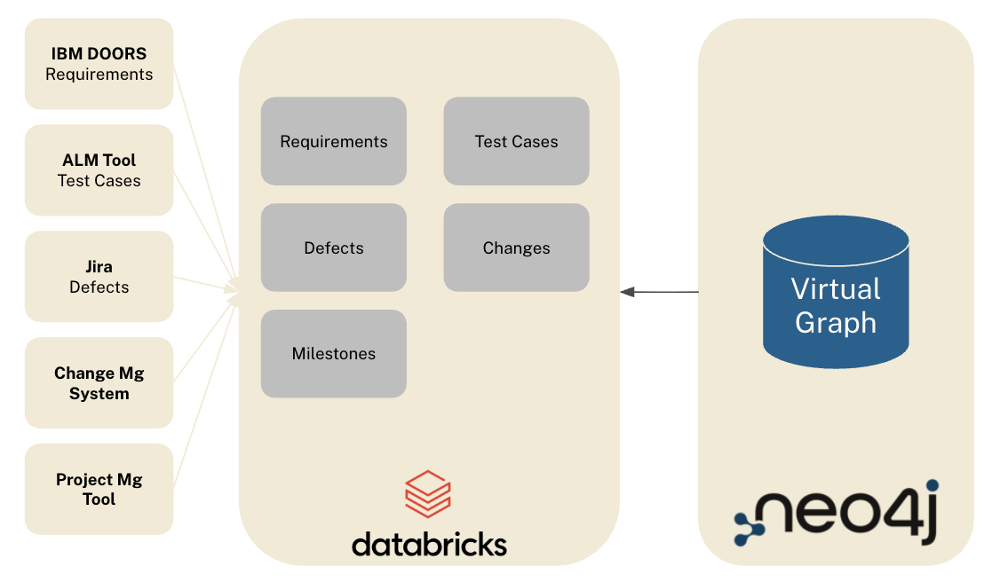
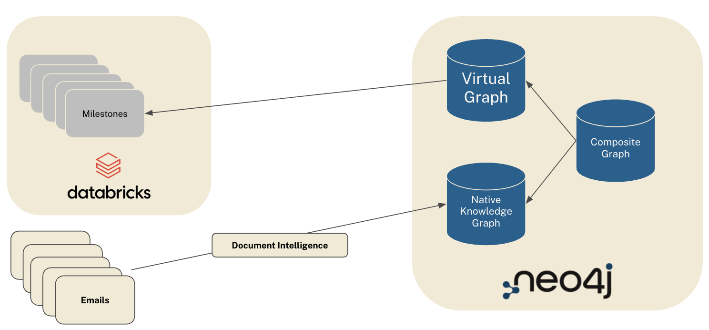

# Neo4j Virtual Graph & Document Intelligence Demo


## Use Case

Engineering knowledge in an automotive program sits in systems that were never designed
to talk to each other:

- Requirements in DOORS, Codebeamer, Polarion or Jama
- Tests in a separate ALM tool
- Defects in Jira
- Change requests in a change management system
- Milestones and maturity in project tracking
- Policies, standards and design guidelines in documents
- Decisions and their reasoning in emails and meeting minutes

Each tool is a silo. A question like "which milestone is at risk because of an open
critical defect, and who owns the affected requirements?" crosses four of them, so it
gets answered in a meeting instead of a query. Late answers turn into late fixes, and a
late fix costs roughly 100 times an early one.

The idea: Create a connected layer on top of the tools that already
exist. Nothing gets replaced. The layer reads from the source systems and makes the
links between them explicit and queryable.

## Architecture

- **Structured lakehouse data** arrives as CSV exports and are accessed via a Virtual Graph
- **Documents** (standards, policies, guidelines, meeting minutes) arrive as PDF and are
  loaded through the Neo4j Document Intelligence capability, which chunks and embeds them and
  extracts entities.


## Knowledge Graph generation with Document Intelligence

[Aura Document Intelligence](https://neo4j.com/docs/aura/document-intelligence/introduction/)
is a preview feature of the Aura console. You upload documents, describe them in a
prompt, let it propose a graph model, refine the model with its agent and run the import.
Upload the 20 PDFs from `documents/` as local files, and paste the prompt below.
```
The documents belong to the engineering program of one electric vehicle, the
Nova EV, built by an automotive OEM. They are working summaries of standards
(ISO 26262-6, UN ECE R100, IEC 62660-2, ISO/SAE 21434), internal policies (change
control, defect escalation, milestone gate, requirement traceability), design
guidelines, best practices and lessons learned, meeting minutes and email threads.

Extract these entities:
- Rule: a numbered rule defined in a standard, policy, guideline or best practice.
  Key ruleId, for example R100-6.1.1, DEP-02, CCP-04, DG-BMS-01, ISO26262-6-9.4.3.
  Properties title and text.
- Meeting: one per minutes or email document. Properties title, date, type.
- Decision: a decision recorded in minutes or emails. Properties statement,
  rationale, date, status.
- Person: name, email, role.
- Requirement (key requirementId, REQ-HVB-0001), Component (componentId,
  CMP-HVB-01), Defect (defectId, DEF-0001), Change (changeId, CR-0001), TestCase
  (testCaseId, TC-00001), TestSet (testSetId, TS-HVB-0001), Milestone
  (milestoneId, MS-A). These already exist in the database, loaded from the
  engineering tools. Extract only their identifier so they can be matched, never
  invent new ones.

Relationships: Document CONTAINS_RULE Rule; Meeting DOCUMENTED_IN Document;
Meeting RESULTED_IN Decision; Person ATTENDED Meeting; Person MADE Decision;
Decision BASED_ON Rule; Decision AFFECTS Requirement, Change, Defect or Component;
Requirement SATISFIES Rule; Person RESPONSIBLE_FOR Requirement, TestCase, Defect
or Change.

Identifiers are uppercase with hyphens and must be used as keys exactly as written.
Dates are ISO format (YYYY-MM-DD).
```

### Demo question on the document graph


> Why was CR-0001 raised, what was decided about it, by whom, and what has happened since?

Expected: the UN ECE R100 working summary version 2.0 raised rule R100-6.1.1 from
100 Ω/V to 500 Ω/V. The Change Control Policy approved it by default under CCP-04 and
named Katrin Jansen as coordinating engineer under CCP-10. The email thread of 2026-06-03
decided a combined retest block on the HIL bench, the Change Control Board of 2026-06-12
approved the change and the retest before MS-D, and the HV Junction Box weekly of
2026-08-27 reports TS-HVB-0003 as passed and two defects resolved on the way. The MS-D
readiness review of 2026-09-15 reports seven of nine test sets passed. Seven documents,
one path from Rule to Decision to Meeting to Person.

## Zero-copy: Virtual Graph on Databricks

[Aura Virtual Graph](https://neo4j.com/docs/virtual-graph/) is a public preview feature
for AuraDB Professional and Business Critical. It puts a graph model over tables in a
lakehouse (Databricks, Snowflake or BigQuery), translates every Cypher query to SQL and
runs it there. Nothing is copied. The tool exports stay in the OEM's data platform, and the graph is a view
on top of them.

### Lakehouse tables

Eight relational tables in `lakehouse_data/`: a foreign key column for every
many-to-one link, a join table only where a link is many-to-many.

| Table | Rows | Content | Foreign keys |
|---|---|---|---|
| `components.csv` | 64 | Component with system and product columns | `parentComponentId` |
| `milestones.csv` | 6 | Milestone | |
| `requirements.csv` | 1,330 | Requirement | `componentId` |
| `test_cases.csv` | 5,142 | TestCase with test set columns | `testSetId`, `milestoneId` |
| `tested_with.csv` | 1,980 | Requirement to TestSet, many-to-many | `requirementId`, `testSetId` |
| `defects.csv` | 1,494 | Defect | `testCaseId` |
| `changes.csv` | 200 | Change | |
| `affects.csv` | 506 | Change to Requirement, many-to-many | `changeId`, `requirementId` |

Upload the eight files as tables into one Databricks schema, create a SQL warehouse and a
read-only personal access token, and follow the
[Databricks quickstart](https://neo4j.com/docs/virtual-graph/aura/getting-started-databricks/)
in the Aura console: create the virtual graph, add the Databricks data source, and let Aura
generate the graph model from the schema.



### A query that is easy on the graph and hard on the lakehouse

It runs on the virtual graph and reads live from Databricks. It is a question
that today gets answered in a meeting, because the answer is spread over several tools.

**Which requirements are being fixed and changed at the same time?**

Two chains that meet on one requirement. Chain one: a planned milestone, a test case
needed for it, an open critical defect found by that test case. Chain two: that same test
case, its test set, the requirement it tests, and a change about to alter that
requirement. Where both hit the same requirement, a fix and a change are running into
each other.

In SQL you write both chains as join lists and join them on the requirement key, seven
joins in total. In Cypher the two chains are two patterns in one MATCH that share the
test case and the requirement. Jira sees the defect, the change tool sees the change,
neither sees the collision.

```cypher
MATCH p1 = (m:Milestone)<-[:PART_OF]-(tc:TestCase)<-[:IDENTIFIED_IN]-(d:Defect),
      p2 = (tc)-[:BELONGS_TO]->(ts:TestSet)<-[:TESTED_WITH]-(r:Requirement)<-[:AFFECTS]-(ch:Change),
      p3 = (r)-[:REQUIREMENT_PART_OF_COMPONENT]->(c:Component)
WHERE m.name = 'Design Validation Complete'
  AND d.severity = 'Critical' AND d.status <> 'Resolved'
  AND ch.status IN ['Proposed', 'Approved']
RETURN p1, p2, p3
```

The same question in SQL:

```sql
SELECT m.name AS milestone, d.defectId AS defect, d.status AS defectStatus,
       r.requirementId AS requirement, c.name AS componentName,
       ch.changeId AS change, ch.status AS changeStatus, ch.cost AS changeCost
FROM defects d
JOIN test_cases   tc ON tc.testCaseId    = d.testCaseId
JOIN milestones   m  ON m.milestoneId    = tc.milestoneId
JOIN tested_with  tw ON tw.testSetId     = tc.testSetId
JOIN requirements r  ON r.requirementId  = tw.requirementId
JOIN affects      a  ON a.requirementId  = r.requirementId
JOIN changes      ch ON ch.changeId      = a.changeId
JOIN components   c  ON c.componentId    = r.componentId
WHERE m.status = 'Planned'
  AND d.severity = 'Critical' AND d.status <> 'Resolved'
  AND ch.status IN ('Proposed', 'Approved')
ORDER BY defect;
```

Expected: 3 rows, all on Design Validation Complete. DEF-1114 on the Gate Driver Board
meets the proposed CR-0163, DEF-0325 on the Thermal Control Unit meets the approved
CR-0032, DEF-0078 on the Head Unit meets the proposed CR-0098.

### Why this is easier in a graph

- **Chains, not joins.** Every step in the question is one relationship in the pattern.
  You do not need to know which table carries which foreign key. The graph model knows.
- **Meeting points.** "Where do a defect and a change collide" is two chains that end on
  the same node. In Cypher they share a variable; in SQL you join two join lists.
- **Counting at the end of the chain.** Per milestone, per component: it is the RETURN
  clause, not a subquery.
 
 ## [NOT IMPLEMENTED] Composite graph
A Composite databases allow queries that access both graphs (the virtual and the materialized knowledge graph) at once.

